# AC Dungeon Maps

3D maps of 46 Asheron's Call dungeons, with routes to quest goals and sweeps for kill tasks. They work in a web browser and inside the game as an OpenAC client plugin. Everything is built from the game's own files, so walls, floors, spawns and portals are where the game puts them.

**Browse the maps:** https://aaronoriginate.github.io/ac-dungeon-maps/

The clips and screenshots below were recorded on a local ACEmulator (ACE) server with the OpenAC client.

## In game

### Arriving in a dungeon

The map opens by itself when you enter a mapped dungeon.

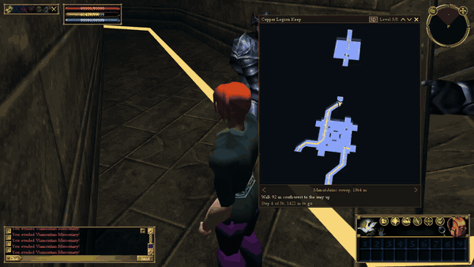

[Full video (MP4)](media/arrive-in-a-dungeon.mp4)

### Following a route

The route is drawn on the floor, and the map follows you, with the next step and the distance left in the footer.

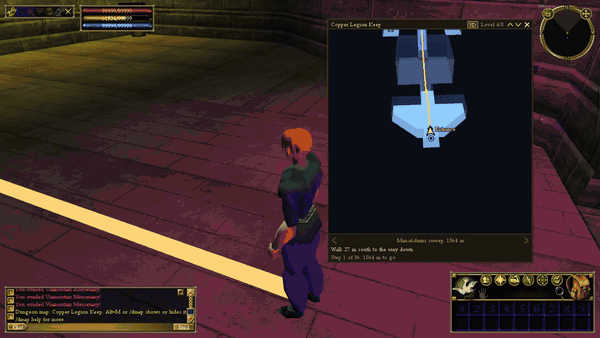

[Full video (MP4)](media/walk-the-route.mp4)

### Turning, tilting and zooming

Drag to turn and tilt the 3D map, scroll to zoom, and use the arrows to show another level.

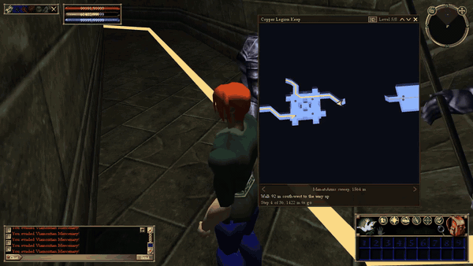

[Full video (MP4)](media/turn-tilt-zoom.mp4)

### Routes and the flat map

Step through a dungeon's routes, or switch to the flat map of one level.

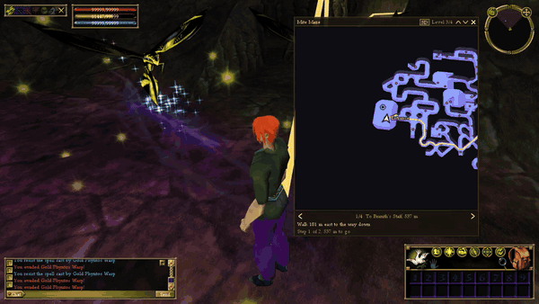

[Full video (MP4)](media/routes-and-2d.mp4)

### Screenshots

| | |
| --- | --- |
| 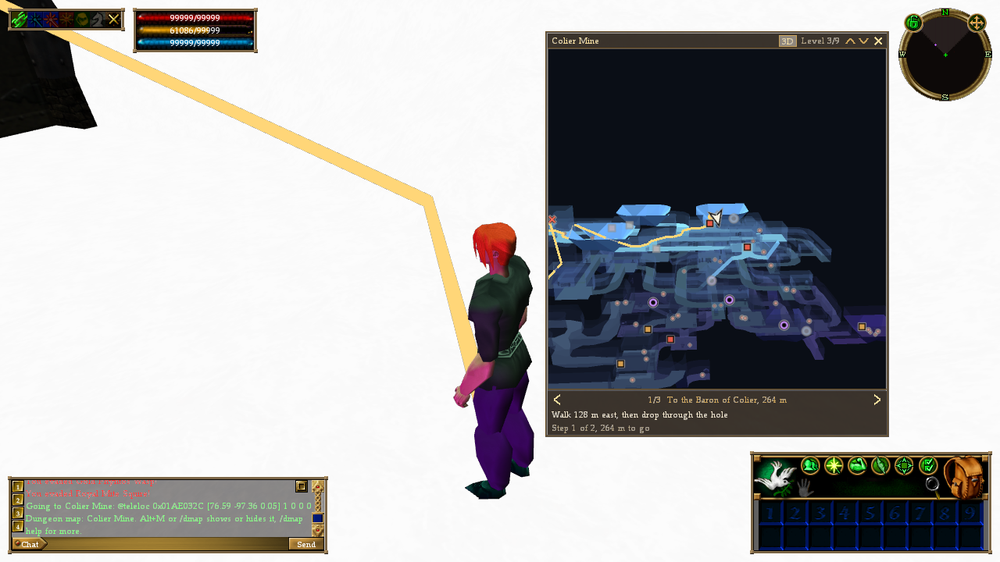 | 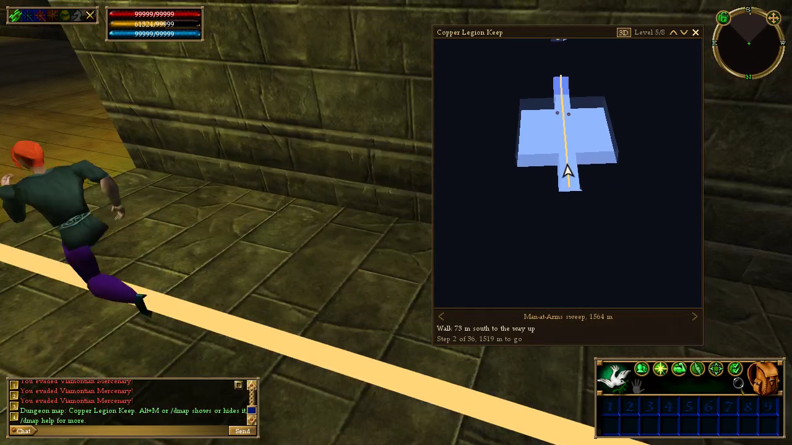 |
| 3D map, Colier Mine | Route on the floor, Copper Legion Keep |
| 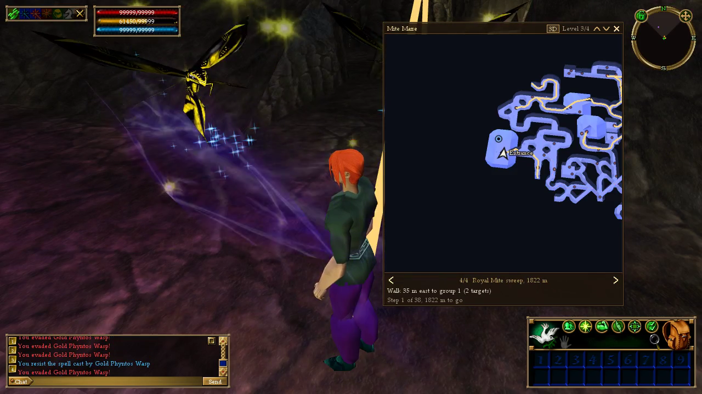 | 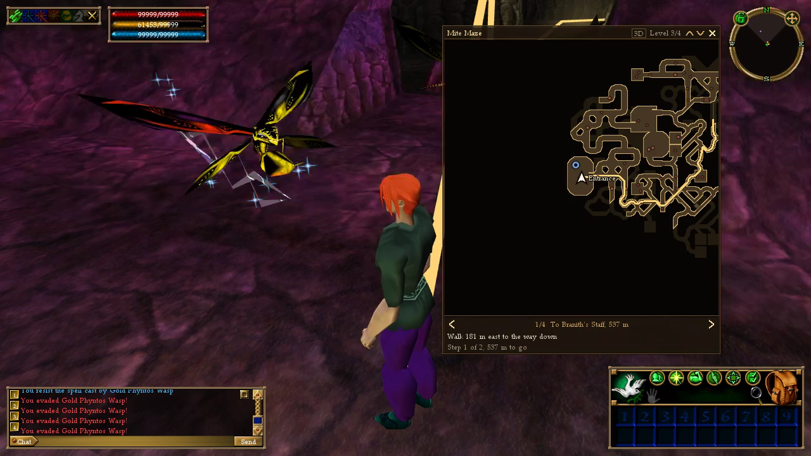 |
| Kill task sweep, Mite Maze | Flat map of one level, Mite Maze |

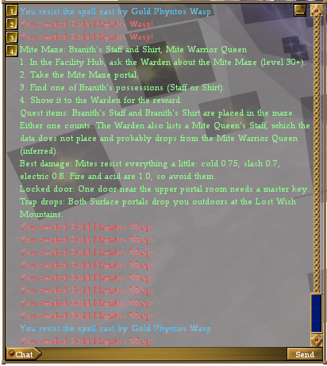

`/dmap info` prints the quest steps and notes for the dungeon you are in.

## On the web

| | |
| --- | --- |
| 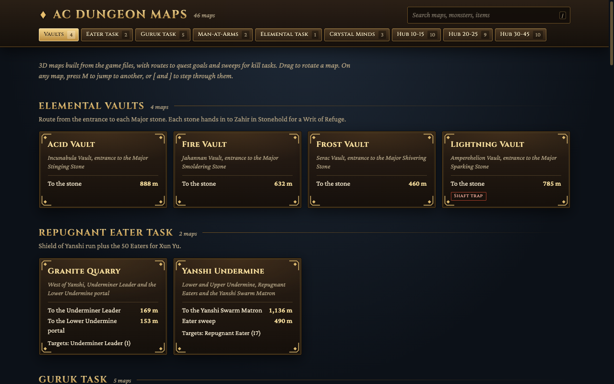 | 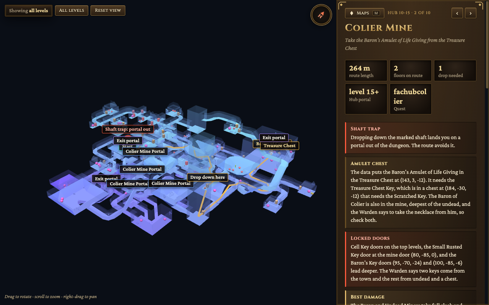 |
| Index of all 46 maps | One map: drag to rotate, notes and routes on the right |

## Controls

| Control | Effect |
| --- | --- |
| Alt+M or `/dmap` | Show or hide the map |
| `3D` in the title bar, `/dmap 3d`, `/dmap 2d` | Switch between the 3D map and the flat map of one level |
| Arrows at the foot of the map, `/dmap next`, `/dmap route [n]` | Change route |
| Arrows in the title bar, Shift+wheel | Show another level |
| Drag, right-drag, wheel | 3D: turn and tilt, slide, zoom. 2D: pan and zoom. Right-click to follow you again |
| `/dmap info` | Quest steps and notes for this dungeon |
| `/dmap lines on`, `/dmap lines off` | Route on the floor |
| `/dmap size small`, `medium`, `large`, `/dmap reset` | Window size, or put the window back |
| `/dmap list` | Every mapped dungeon |
| `/dmap goto <dungeon>`, `/dmap tp <marker>` | Admin only, for a local test server: teleport with ACE's `@teleloc` |

## How it is made

1. **Geometry.** `mapgen/tools/acdat.py` reads the client's dat files directly. Each dungeon is a landblock of indoor cells. The cell file gives each cell's position and environment, and the portal file gives the environment shapes, so every wall, floor, ramp and doorway comes from the game.
2. **World data.** Spawns, chests, levers, portals, locked doors and monster stats come from the ACE world database (ACE-World-16PY with its patches). `mapgen/weenies.json` is the slice of it the maps use.
3. **Walk graph.** `mapgen/tools/dunmap.py` links cells through their portals, finds the walkable floors and ramps, and marks the holes you can drop through. A shortest-path search over that graph gives routes from the entrance to each quest goal, and a sweep that visits every spawn of a kill task's target.
4. **Web maps.** Each dungeon becomes one self-contained HTML page (in `docs/`) with its geometry and routes embedded, drawn with three.js. `dunmap_index.py` builds the index page.
5. **Plugin data.** `mapgen/tools/export_all.py` writes the same maps for the plugin: one floor image per level, a JSON file with routes, markers and notes, and a mesh for the 3D view.
6. **In game.** The plugin (`plugin/`) finds the dungeon you are in, draws the map window and puts the route on the floor. OpenAC's plugin canvas only draws 2D, so the plugin renders the 3D view itself on a background thread and shows it as an image.

Each dungeon is set up by a small config in `mapgen/configs/` that names the targets, goals and entrances.

**To make a new map**, see [GUIDE.md](GUIDE.md): where the raw data is, how to find a dungeon and read what is inside it, how to research its quest, and how to write, build and test its config.

## What it uses

| Part | Uses |
| --- | --- |
| Generator | Python 3 with numpy and Pillow |
| Web maps | three.js 0.128 with OrbitControls |
| Plugin | C# on .NET 10, against the OpenAC 0.1.32 plugin API |
| Game data | Asheron's Call client files (`client_cell_1.dat`, `client_portal.dat`) and the ACE-World-16PY world database |
| Testing | ACEmulator server and the OpenAC client in Docker |

## Folders

| Folder | Contents |
| --- | --- |
| `docs/` | The web maps (served by GitHub Pages) |
| `mapgen/` | The generator, its configs and the world data slice |
| `plugin/` | The OpenAC plugin, its map data and marker art |
| `media/` | The videos and screenshots on this page |

## Building

The game's dat files are not included. The generator expects to sit next to them in a workspace like this:

```
workspace/
  ac-dungeon-maps/            this repository
  game-data/client-files/     your client_cell_1.dat and client_portal.dat
  clients/OpenAC/             an OpenAC checkout, for building the plugin
  world-data/                 ACE-World-16PY and ACE-World-16PY-Patches
```

```sh
python3 mapgen/tools/weenie_index.py                          # refresh mapgen/weenies.json from the world data
python3 mapgen/tools/find_dungeon.py "mite maze"               # find a dungeon's landblock and entrances
python3 mapgen/tools/dunmap.py mapgen/configs/mite-maze.json   # one web map, written to workspace/maps
python3 mapgen/tools/dunmap_index.py                          # the index page and nav.js
python3 mapgen/tools/export_all.py                            # plugin data for every config
./build.sh                                                    # build the plugin with the .NET SDK in Docker
```

To install the plugin in OpenAC, copy the built files into OpenAC's plugins folder as `ac.dungeon-maps`. See `plugin/README.md` for details.

## License

The code, maps and guide are under the [MIT License](LICENSE).

`mapgen/weenies.json` is extracted from the ACE-World-16PY database, which is under the AGPL-3.0, so that file keeps its terms. Asheron's Call and its game content belong to their owners; this project is not affiliated with them.
